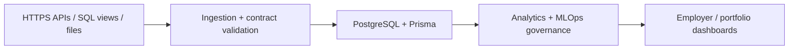

# Financial Wellness Dashboard & Data Integration

> **Status:** Active engineering; see original README for release-specific status  
> **Technology focus:** TypeScript · Fastify · React · Prisma · PostgreSQL  
> **Maintainer:** Cayelaem Jantjies

## At a glance

**The challenge:** Unify multiple external finance and workforce data feeds into dependable tenant-aware dashboards.

This is a project-specific technical showcase, not a claim that every proposed capability is live. The repository's README and implementation remain the source of truth for release status.

## System journey (conceptual)

*Diagram describes the documented workflow at a high level, not a verified live infrastructure topology.*

## Engineering deep dive

### 1. Ten-dataset canonical ingestion contract and data-quality guardrails

This area illustrates a concrete engineering consideration in the project. Inspect the implementation, tests, and source contracts to establish the precise current behaviour and implementation maturity before using it in a live environment.

### 2. Snapshot-aware reporting, null-safe metrics and role-aware access

This area illustrates a concrete engineering consideration in the project. Inspect the implementation, tests, and source contracts to establish the precise current behaviour and implementation maturity before using it in a live environment.

### 3. Governed model registry, feedback and operational telemetry

This area illustrates a concrete engineering consideration in the project. Inspect the implementation, tests, and source contracts to establish the precise current behaviour and implementation maturity before using it in a live environment.

### 4. Release checks for security, imports, UI and performance

This area illustrates a concrete engineering consideration in the project. Inspect the implementation, tests, and source contracts to establish the precise current behaviour and implementation maturity before using it in a live environment.

## Engineering evidence checklist

| Evidence | How to evaluate |
| --- | --- |
| Architecture | Trace actual components, data flow, trust boundaries and dependencies in this repository |
| Data integrity | Verify schema, validation, migrations and failure handling against test cases |
| Reliability | Check logging, error recovery, retries and existing test outcomes |
| Security | Review auth, tenant isolation, secrets handling and data access controls |
| Product quality | Check accessible UX, responsive layouts, empty/error states and real screenshots |
| Deployment | Verify runtime variables, CI results and the currently active hosting configuration |

## Visual gallery

Real, approved screenshots, device mockups and dashboard visuals belong in a future `docs/media/` gallery. **No screenshot is displayed here until a real application view is captured, sanitised and approved.** The Mermaid flowchart above is a renderable architecture visual that works directly on GitHub.

## Known limitations and honest status

This repository's older README still describes Railway. Verify current Render/Cloudflare cutover and runtime configurations before treating deployment instructions as current.

## Further reading

[Back to repository README](../README.md) · [Cayelaem's engineering profile](https://github.com/CayelaemJ)
