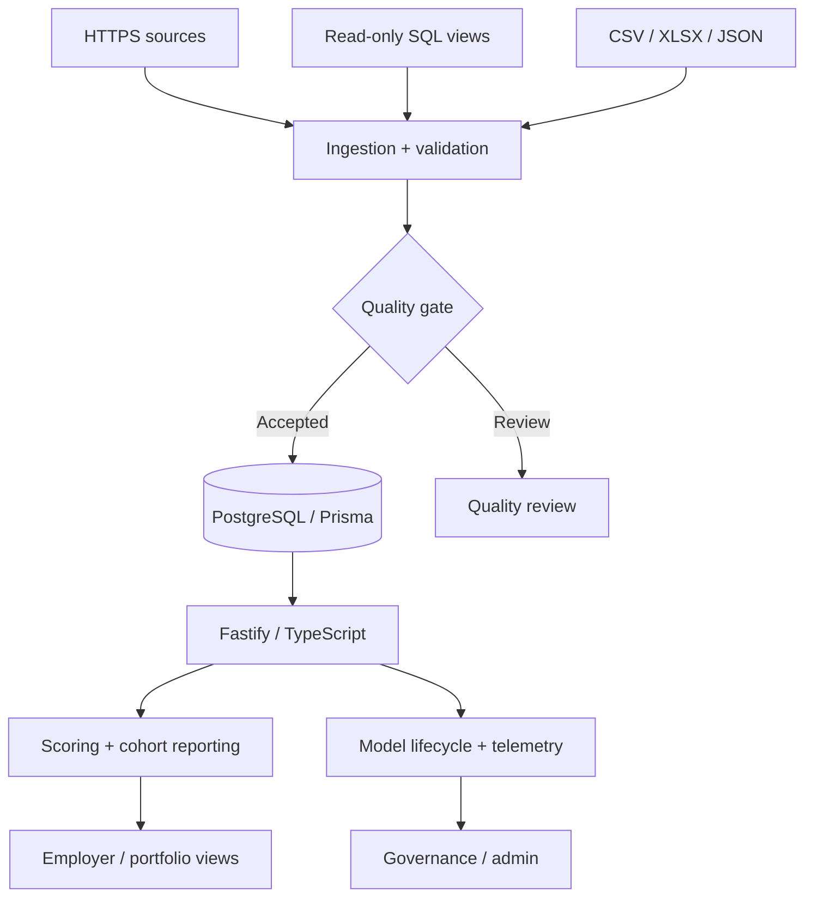

# Financial Wellness Dashboard — Engineering Case Study

**Repository identity:** `empower-fin-dashboard-portal`, version 0.10.0 in the inspected `package.json`. **Hosting documentation contains legacy Railway references**; deployment cutover is not verified here.

## Problem

Multiple API, SQL and file sources must become trustworthy and historically meaningful employer and portfolio metrics, without violating access boundaries.

*Logical diagram grounded in the repository README, not a verified live topology.*

## Deep dive

**Contract-driven ingestion:** The README specifies 10 canonical datasets: employers, workforce_snapshots, employees, platform_users, journeys, debt_accounts, policies, ratings, referrals and salary_advances. It separates external data ingestion from browser-facing credentials.

**Reporting semantics:** Event dates, effective observation dates and technical change timestamps are not interchangeable. Snapshot-aware queries and null-safe metrics help avoid misleading historical reports.

**Governed analytics:** Model lifecycle, drift/anomaly monitoring, audit records and human feedback are documented alongside conventional reporting.

**Operational quality:** The inspected package defines Node 24, separate frontend build, Prisma generation and extensive regression scripts. Their existence does not prove they currently pass.

| Domain | Repository command |
|---|---|
| Aggregate validation | `npm run check:all` |
| Security | `npm run check:security` |
| Imports | `npm run check:imports` |
| React parity | `npm run check:react` |
| Accessibility | `npm run check:accessibility` |
| Performance | `npm run check:performance` |

## Visual evidence plan

Capture a synthetic-data dashboard, ingestion workflow and administrative diagnostics, with all company identities and personal data removed. Only publish benchmark graphs with a stated fixture, run date, environment and observed values.

[Back to README](../README.md) · [Architecture](ARCHITECTURE.md) · [Testing](TESTING.md)
