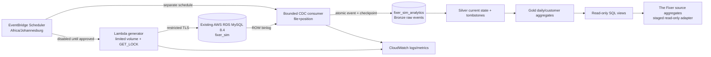

# The Fixer | Synthetic AWS RDS MySQL + True Binlog CDC

**Status: development implementation, not production activated.** Generated 2026-11-06. This is installable code with isolated test assets, not a claim that it already runs on AWS. The `CayelaemJ/NewChanges` production application and its credentials are untouched.

## What this package does

- Operates **only** in `fixer_sim` (source) and `fixer_sim_analytics` (sink). No SQL DDL or mutations against application schemas.
- Simulates inserts, upserts, bulk customers, orders, payments, order status/price updates, historical corrections, late arrivals, logical customer deletion, synthetic financial-transaction hard deletion, duplicate business events, controlled failed transaction and explicit rollback.
- Uses deterministic `SIM_RUN_KEY` and seed, unique business-event keys, bounded volume of 1..200 orders/run, `GET_LOCK` concurrency guard, and a **second DB-backed emergency stop** (`sim_control.enabled=FALSE` by default).
- Reads **actual MySQL row binary logs**, not `updated_at` polling. Supports INSERT/UPDATE/DELETE, durable file/position checkpoint, event-level idempotency and replay, Bronze raw row payloads, Silver current-state/tombstones and targeted Gold daily/customer reaggregation.
- Exposes SQL views: `fixer_sim_analytics.v_daily_sales`, `v_customer_activity`, `v_daily_transactions`, `v_cdc_latency`, `v_cdc_worker_runs`, `v_pipeline_quality`.
- Provides disabled-by-default AWS Lambda + EventBridge Scheduler infrastructure with South African timezone and CloudWatch logs; optional error alarms.

## Verified cloud discovery, 6 November 2026

AWS APIs reported `fixer-synthetic-mysql` in `eu-north-1`: MySQL 8.4.11, `db.t4g.micro`, gp3 20 GB, available, **publicly accessible**, backup retention 1 day, deletion protection enabled, storage encryption enabled, Single-AZ, Enhanced Monitoring disabled, Performance Insights disabled. One ingress rule TCP 3306 was scoped to an IPv4 CIDR and **not** `0.0.0.0/0`. No region Lambda functions or EventBridge Scheduler schedules existed at inspection, and no CloudWatch alarms with prefix `fixer` were present. CloudWatch recorded CPU between about 3.4% and 15.8%, and up to three DB connections in the inspected 3-hour window. This is a momentary snapshot, not a sizing guarantee.

**Live SQL read-only evidence, 6 November 2026:** An operator's DBeaver query reported MySQL `8.4.11`, `log_bin=1`, `binlog_format=ROW`, `binlog_row_image=FULL`, and a valid active RDS binary-log status. The inspected account could see 21 tables in `ingest_stage`, with no other non-system schemas returned by its metadata query. This is visibility scoped to that account, not a guarantee that no other schemas or sensitive data exist. The read-only queries updated zero rows. The observed binary-log position is **not** a valid seed for a new CDC checkpoint. No simulation schemas or accounts were created by these checks.

**Still not verified:** binary-log retention configuration, account privileges and exposure to other schemas through replication, sensitive-data classification for `ingest_stage`, table structure/row volume, free storage headroom, TLS connection validation, and runtime access with dedicated writer/reader/sink accounts. The simulation's `fixer_sim` and `fixer_sim_analytics` schemas have **not** been verified or installed on live RDS. AWS RDS management APIs do not expose a regular MySQL server's table data and `information_schema` over the RDS Data API. Use read-only metadata queries before any separately approved deployment.

**Important data security caveat:** MySQL `REPLICATION SLAVE` / `REPLICATION CLIENT` are global privileges, and replication can expose events from other schemas **even when the consumer software filters to `fixer_sim`**. Do not grant binlog access on a mixed sensitive-data instance until its data classification and privileged-access review have passed. For isolation beyond an application-side filter, use a dedicated MySQL instance (new cost, separately approved).

## Architecture



Bronze, Silver and Gold are logical data layers in one small MySQL instance. They do not require S3, DMS, Kafka, Kinesis or another paid analytics cluster. This comes with limits: binlog churn and Gold computation share the micro instance. Benchmark sustained change volume before increasing throughput. If volume grows, move analytics storage and the consumer off the source RDS.

## DEV: run isolated Docker tests first

Requirements: Python 3.12+, Docker Engine + Compose, local ability to pull `mysql:8.4` and `python:3.12-slim`. The Compose file has **no exposed MySQL host port**, runs on an **internal network**, uses tmpfs for database files, and creates short-lived random credentials. It **cannot connect to live RDS**, because service hostnames are fixed as `mysql` inside the private network.

```bash
cd aws-rds-sim
bash ops/ci-docker.sh
```

The script first runs pure unit tests, then creates a disposable MySQL 8.4 instance, installs isolated schemas, grants synthetic test accounts, establishes a binlog checkpoint while source tables are empty, runs simulation, checks FK/idempotency/rollback, exercises INSERT/DELETE row transformations and **attempts an actual binlog read**. It tears down its own Docker project including ephemeral data.

The simulation rechecks the emergency-stop flag before every committed business event, retains the original run anchor for retries, and recomputes Gold metrics using indexed affected-day SQL ranges. The MySQL integration suite asserts real binlog DELETE events and replay idempotency. The operator supplied the complete final test transcript on **12 November 2026** for commit `22d7fd29`: **91/91 tests passed** in disposable Docker MySQL 8.4 with no skips and test container exit code **0**. The host-only phase separately completed 91 tests with 16 expected environment-dependent skips. The test run includes the new atomic ingest-stage metadata sink, replay/rollback contracts and Docker fixture checks.

Pure Python tests alone do **not** establish CDC integration. The final operator Docker transcript verifies **local** binlog consumption, physical DELETE events, replay deduplication, timestamp updates and historical-date handling. It does not verify connectivity to **this AWS RDS instance**, nor a live `ingest_stage` source consumer. The dependency `mysql-replication==1.0.17` is pinned; production binlog and TLS access remain unverified.

For the existing self-hosted `newchanges-ci` GitHub runner, copy these files under `NewChanges/simulation/` and copy `repo-integration/.github/workflows/aws-sim-docker-ci.yml` to the repository's `.github/workflows/`. Dispatch that workflow manually. It does not use GitHub-hosted runners and does not deploy.

## Precise source freshness and mutation timestamps (6 November 2026)

**Implemented in this PR for new `fixer_sim` installations; NOT deployed
to RDS and NOT applied to existing `ingest_stage` data.**

- Source `updated_at` columns use MySQL 8.4 `DATETIME(6) DEFAULT
  CURRENT_TIMESTAMP(6) ON UPDATE CURRENT_TIMESTAMP(6)`; `order_items`
  and simulation run status also now have automatic `updated_at`.
- The simulator uses `UTC_TIMESTAMP(6)` inside each actual INSERT/UPDATE.
  A retry or no-op duplicate must **not** change the original source row's
  modification time. Every committed event in `business_events` records
  its actual database execution time, including the audit for physical DELETE.
- Every dedicated MySQL connection sets its session time zone to `+00:00`.
  An external DBeaver session should also use `SET time_zone='+00:00';`
  before manual updates to `fixer_sim` to preserve UTC DATETIME semantics.
- `ordered_at`, `payments.event_at`, and `financial_transactions.occurred_at`
  reflect the business time. Late-arriving historical events intentionally
  retain their historical dates even when `updated_at` is today.
- A new `fixer_sim.v_source_freshness` read-only view returns the most recent
  source modification in UTC for each table, plus the latest business audit
  event and simulator run. Physical DELETE does not leave a source row, so
  its committed `business_events` audit timestamp is the source-side marker.
- Regression tests now verify direct SQL UPDATE without an explicit
  `updated_at`, a fresh MySQL timestamp, the source freshness view,
  automatic schema on-update rules, and historical business-date separation.

After separately approved schema installation, a DBeaver user with restricted
read access can inspect freshness via:

```sql
SELECT source_table, last_changed_at_utc,
       TIMESTAMPDIFF(SECOND, last_changed_at_utc, UTC_TIMESTAMP(6))
           AS seconds_since_change
FROM fixer_sim.v_source_freshness
ORDER BY last_changed_at_utc DESC;
```

**Current RDS findings:** `ingest_stage` contains 11 base tables and 10
views (21 objects). Two column names matched a limited sensitive-name filter,
but that is **not** a classification of data in tables such as `employees`,
`platform_users`, or `salary_advances`. The inspected administrative account
has the `rds_superuser_role`; do not use it as the simulation runtime identity.
The live `binlog retention hours` configuration returned a blank value,
which AWS documents as NULL, meaning zero guaranteed retention hours for
RDS MySQL. A retention change (e.g. 24 hours) can increase storage use on
the existing 20 GB instance and requires measured headroom and explicit
approval. `source delay=0` and `target delay=0` do not establish CDC
consumer latency. No production change has been performed.

## MySQL 8.4 SHA-2 authentication (local Docker)

MySQL 8.4 defaults to `caching_sha2_password`. Fresh Docker test accounts
require PyMySQL RSA authentication support when using the isolated, non-TLS
Docker network. The test image installs `PyMySQL[rsa]` and pins `cryptography`.
The Docker build verifies these imports, and the preflight checks the backend
and all three restricted account connections **before** CDC bootstrap.

The previous symptom was five `RuntimeError` preflight failures immediately
after local role creation. This was consistent with PyMySQL's missing
`cryptography` dependency, not five independent schema failures. Re-test
against fresh containers; do not disable SHA-2 authentication, weaken
production TLS, or bypass the kill switch.

## Troubleshooting Docker CDC bootstrap (local only)

Before calling `runtime.cdc bootstrap`, Docker runs a **read-only, local-only**
probe which prints one JSON record per stage:

`replica_connection_and_stop`, `source_empty`, `row_binlog_configuration`,
`binlog_status_privilege`, and `analytics_sink_connection`. The final
`local_cdc_preflight` field is `PASS` or `FAIL`. No real database host,
username, SQL exception body or password appears in these records.

If all preflight stages pass but bootstrap raises an unexpected RuntimeError,
the CLI emits `CDC_BOOTSTRAP_STAGE_FAILED` with one of these fixed `stage`
values: `SOURCE_CONNECT`, `SINK_CONNECT`, `SIMULATION_STOP`,
`EMPTY_SOURCE`, `BINLOG_PREFLIGHT`, `SINK_CHECKPOINT`,
`CHECKPOINT_WRITE`. This intentionally does not invent a root cause.
Use the failed stage and MySQL error number (if available) to repair only
the disposable test setup. Never disable the empty-source guard on live RDS.


A failed bootstrap writes a JSON object to stderr containing a fixed `error_code`
rather than printing database driver details. This is intentional: connection
exceptions may include sensitive SQL or host/account details.

| Code | Meaning |
|---|---|
| `CDC_APPROVAL_REQUIRED` | The bootstrap approval environment variable is missing |
| `CDC_SIMULATION_NOT_STOPPED` | The DB kill switch is enabled or missing |
| `CDC_SOURCE_NOT_EMPTY` | At least one synthetic source table contains data; use an approved snapshot hand-off |
| `CDC_LOG_CONFIG_UNSUPPORTED` | Server is not running with binary logging + ROW/FULL images |
| `CDC_BINLOG_STATUS_EMPTY` | The server did not return an active binary-log position |
| `CDC_CHECKPOINT_ALREADY_EXISTS` | A checkpoint already exists; never reset it automatically |

For a local PyMySQL error, output also includes a numeric `mysql_errno`
without any error message, credentials, or connection URL. Do not bypass
bootstrap safety guards to make tests pass. The local Compose test project
uses randomly generated credentials and fresh ephemeral storage every run.

## Local MySQL 8.4 integration validation, 6 November

The operator's disposable MySQL 8.4 log now confirms the RSA dependency,
writer/replication/sink authentication, stopped-and-empty source checks,
`ROW`/`FULL` binlog configuration, binlog access, and initial empty-source
checkpoint bootstrap **PASS**. Three CDC data-layer integration tests and
the isolated generator idempotency test also passed.

The remaining two failures in that run were test-image packaging
(`/app/Dockerfile.test` absent) and a removed constructor parameter
(`fail_on_table_metadata_unavailable`) in the installed
`mysql-replication==1.0.17` reader. Both are fixed in the branch, with a new
test inspecting `BinLogStreamReader` against the installed API. The complete
live row-binlog integration test must still be rerun to prove success.

## Approval gates before **any** AWS schema creation

1. Verify actual MySQL schema inventory and classify sensitive data. No connection to live RDS was attempted from this package.
2. Review 3306 SG rule and authorize Lambda security-group-to-RDS ingress in the same VPC. No automatic RDS SG changes.
3. Confirm daily available free space, active RDS backup/restore expectations and permitted extra binlog retention. Current backup retention is 1 day. Changing it requires an explicit decision.
4. Verify `@@GLOBAL.log_bin=ON`, `@@GLOBAL.binlog_format=ROW`, `@@GLOBAL.binlog_row_image=FULL`, and `CALL mysql.rds_show_configuration`. For recovery, set an appropriate binlog retention window **only after separate approval**, then monitor free storage. This code does not set RDS parameters or retention.
5. Create the source/sink schemas with dedicated administrator-approved migration execution of `schema/*.sql`; do not run migrations on the application schema. Source and sink defaults are disabled. Run **restricted users**, never root/admin.
6. Provide distinct writer (`SELECT/INSERT/UPDATE/DELETE` on `fixer_sim.*`), consumer sink (`SELECT/INSERT/UPDATE/DELETE` on `fixer_sim_analytics.*`), and replica reader (`SELECT` on `fixer_sim.*` plus global replication privileges) accounts. Replication globally exposes other schemas: review this separately.
7. If the source is empty, run `python -m runtime.cdc bootstrap` with `SIM_CDC_BOOTSTRAP_APPROVED=YES_EMPTY_SOURCE_ONLY` **while sim_control is disabled**, before inserting anything. If it is nonempty, **stop**: this package intentionally has no unsafe initial-snapshot shortcut. An atomic snapshot/binlog handoff must be implemented and tested first.
8. Only after tests and consent, set `sim_control.enabled=TRUE` in `fixer_sim` for a restricted operator, enable the synthetic writer approval env, then manually invoke and monitor one low-volume run. Keep schedules disabled until successful verification.

## Local CLI / worker commands

All database credentials must be injected from local secret management or AWS Secrets Manager. **Never print connection strings, log driver errors, or add secrets to GitHub.** The non-local driver requires certificate-verified TLS and an explicit CA path.

```bash
# illustrative environment keys, never commit values
SIM_ENV=aws
SIM_DB_HOST=<approved-host>  SIM_DB_USER=<dedicated-writer>
SIM_DB_PASSWORD=<from-secret> SIM_DB_DATABASE=fixer_sim
SIM_DB_CA=/path/to/rds-global-bundle.pem
SIM_REPL_HOST=<approved-host> SIM_REPL_USER=<dedicated-binlog-reader>
SIM_REPL_PASSWORD=<from-secret> SIM_REPL_DATABASE=fixer_sim
SIM_REPL_CA=/path/to/rds-global-bundle.pem
SIM_CDC_HOST=<approved-host> SIM_CDC_USER=<dedicated-sink-writer>
SIM_CDC_PASSWORD=<from-secret> SIM_CDC_DATABASE=fixer_sim_analytics
SIM_CDC_CA=/path/to/rds-global-bundle.pem
```

```bash
# read-only preflight after restricted source access exists
python -m runtime.cdc preflight
# ONLY for a new, empty, STOPPED simulation source
SIM_CDC_BOOTSTRAP_APPROVED=YES_EMPTY_SOURCE_ONLY python -m runtime.cdc bootstrap
# ONLY after schema/control/user consent
SIMULATION_WRITES_APPROVED=YES_ISOLATED_SYNTHETIC_ONLY SIM_RUN_KEY=manual:20261106:001 python -m runtime.simulator
# consumer is separate, reads REAL row-binlog events
SIM_CDC_ENABLED=true python -m runtime.cdc consume
```

Never run `bootstrap` over a nonempty database. It explicitly rejects this condition and existing checkpoints.

## AWS packaging and deployment (not executed)

`infra/main.tf` targets `eu-north-1`. It creates two restricted-concurrency Lambda functions, Scheduler rules, IAM roles, CloudWatch logging, and optionally error alarms, **only when `deploy=true`**. Both schedules remain `DISABLED`, both Lambda functions have `SIM_LAMBDA_ENABLED=false`, and the generator additionally has `SIMULATION_WRITES_APPROVED=NO`. Deploying infrastructure does **not** automatically activate simulation.

The build helper requires the official AWS RDS CA bundle at `ops/rds-global-bundle.pem`. The file is intentionally not included. Retrieve from the official AWS RDS trust store, validate its source, then build with `bash ops/build-lambda.sh`. An approved existing Secrets Manager JSON secret must supply exact `SIM_DB_*`, `SIM_REPL_*`, `SIM_CDC_*` keys. Terraform **does not create the secret**. Secrets Manager access from private Lambda subnets may need a NAT gateway or VPC Interface Endpoint: **both can add costs**, so approve the network path first.

```bash
cd infra
terraform init
terraform plan   # deploy=false by default: should plan NO resources
# STOP: do not terraform apply or set deploy=true until permissions/pricing sign-off.
```

Intended generator schedule: 08:00, 12:00 and 17:00 South Africa time daily; separate CDC drain every minute. The generator uses the supplied scheduled timestamp to give retry-safe run keys; individual Lambda concurrency is limited to one, and MySQL uses named locks. Lambda has a 90-second timeout and bounded 200-row/40-second CDC work window. No claim has been made that Lambda VPC connectivity, actual role permissions, or runtime resource limits pass yet.

### Emergency stop and rollback

1. Set both EventBridge schedules to `DISABLED` and `SIM_LAMBDA_ENABLED=false`; this prevents new worker actions.
2. Set `fixer_sim.sim_control.enabled=FALSE` (writer fail-closed), and set CDC env `SIM_CDC_ENABLED=false`.
3. Verify there are no active simulation transactions or CDC worker processes; inspect worker run views and CloudWatch errors.
4. Preserve Bronze and checkpoints for forensic replay. **Do not delete the simulation schema or reset the CDC checkpoint automatically.** Re-enable only after an explicit recovery decision.
5. No production application configuration is changed by this package, so the existing application requires no connection rollback.

### Recovery and ordering rules

- The reader stores `source_file + log_pos` alongside Bronze and Silver/Gold changes in the **same sink transaction**. Crash before commit replays the event; replay is deduplicated on `(file,position,row_index)` hash. Crash after commit resumes from the stored checkpoint.
- MySQL may purge a binlog file before resumption. If the required file is missing, **fail closed** and perform an independently approved snapshot/reseed; do not jump to latest position.
- Within this single reader, row-binlog coordinates preserve source order; there is **no distributed exactly-once delivery guarantee** outside this transactional sink. Arbitrary transaction group boundaries and binlog rotation need validation under local failure injection.
- The CDC consumer deliberately processes only the allowlisted tables and requires complete row images. Unexpected schema and unsupported events are rejected. Schema migrations/DDL are **not** automatically applied to Silver.
- Gold recalculates **touched days and customers** only. It does not full-refresh all reports after every change. Historic corrections affect the relevant historical reporting date, not only today.

## The Fixer integration

The existing repository has `src/services/sourceAdapter.ts`, `syncService.ts`, `syncJobs.ts`, `dataQualityService.ts`, `playgroundMysqlSnapshot.ts` and an existing `SOURCE_AGGREGATES` reporting path. **Do not replace the live IntegrationConfig or PostgreSQL read model.** First prove a staged, read-only MySQL adapter with exact mapping from `fixer_sim_analytics.v_daily_sales` and `v_customer_activity` to a new simulation-specific analytics view. The existing ten-feed canonical import workflow is *not* a direct drop-in for this schema. Source-level CDC and Gold publication need their own status in the app. A standalone MySQL connection in DBeaver can inspect these views without any app cutover. Grant the dashboard account `SELECT` on approved views only.

## Cost review, region eu-north-1

- AWS Pricing API returned **USD 0.016 per db.t4g.micro instance-hour** for Stockholm, Single-AZ MySQL, which is roughly **USD 11.68 for 730 hours**, **before gp3 storage, backups, network, monitoring, credits/free-tier eligibility or tax**. This is the underlying existing RDS compute, not an incremental simulation estimate.
- Scheduler publishes a Free Tier allowance of 14 million invocations/month, subject to applicable account terms. For a hypothetical 1-minute CDC schedule (~43,200/month) and 3 daily generator invocations (~90/month), scheduler request usage is far below the published allowance; Lambda compute, CloudWatch, Secrets Manager, endpoint/NAT and RDS storage costs are separate. **Free Scheduler does not make Lambda+VPC networking free.**
- The Cost Explorer query for 1–6 November showed no positive unblended service charges in the returned result. That is **not** evidence that the running RDS instance is free or will remain free; costs can lag or be covered by credits.
- Do not deploy DMS, Kinesis, MSK, NAT gateways, VPC endpoints, CloudWatch alarms or new instances without an itemized cost and explicit approval. No paid resources were provisioned during development.

The operator's latest complete WSL transcript from **13 November 2026**
confirms **106/106 disposable MySQL 8.4 Docker tests passed, no skips,
test container exit code 0**, at code commit `5f56f653`. The host
phase passed 106 tests with 19 expected integration skips. This includes
the explicit XID-based local `ingest_stage` CDC bridge, durable restart
from the checkpoint, per-consumer notification and event isolation, source
delete/tombstone handling, idempotency and rollback. The older 91-test
record elsewhere in this document describes a historical milestone only.
**This does not verify live RDS CDC, a source snapshot or production
application integration.**

### Latest verified local milestone: ten-feed XID coverage (107/107)

The **106/106 Docker PASS at code commit `5f56f653`** below is the
last operator-verified runtime baseline. Later commits expand the
**disposable-only** `ingest_stage` fixture from two to all ten canonical
feed names; the local reader derives the exact allowlist from
`FEED_TABLES` and the three-transaction integration test now checks
one multi-feed XID with ten markers and an atomic checkpoint.
One new safety test asserts that the fixture and reader share the exact
allowlist. The operator's **13 November 2026** WSL transcript, after pulling
code commit `faac2fb4`, confirms **107/107 Docker tests passed**, with
no failures or skips and test container exit code **0**; the host phase
ran 107 tests with 19 expected environment skips. No RDS source read,
live binlog reader activation or application-dashboard cutover is implied.

### TypeScript read-only MySQL reporting reader: disabled pending approval (13 November 2026)

`src/services/ingestStageCdcMysqlReader.ts` is a new
**application-native, not-yet-wired** MySQL reporting view reader.
It avoids `syncService.ts` and PostgreSQL reporting upserts,
requires an explicit approved/snapshot-verified trusted caller,
and denies the recovered RDS master account. No route calls this
service; nothing reads live AWS RDS until a future reviewed rollout.

The reader uses RDS TLS CA validation **plus
`ssl.verifyIdentity: true`** (required for mysql2 hostname checks),
selects only report-format declared fields from the ten allowlisted
views, parameterizes a trusted tenant `employer_ref`, and runs
bounded, timeout-controlled **read-only snapshot transactions**.
It fails closed on missing required columns, employer scope mismatch,
database errors, or source feeds exceeding the configured maximum,
rather than publishing partial data.

Initial implementation uses at most **2,000 source rows per
feed/employer/read** and returns only in-memory records. This is
a *safety limit*, not proof the existing larger RDS feeds will fit;
scalable per-employer aggregation and cache publication need a
separate reviewed implementation. No direct HTTP endpoint exists,
so no raw workforce or financial records are exposed externally.

`tests/ingest-stage-cdc-mysql-reader.test.ts` adds **10 mocked
Node regression tests**, invoked by `npm run check:cdc-dashboard`.
Use `npx tsc --noEmit` for TypeScript compilation as an independent
check. **Both checks are pending the operator's WSL run.**
The separately verified Python/disposable MySQL suite remains
**118/118 PASS**; it is not increased by the new Node tests.
No extra RDS service, DB privilege, connection, source query,
application deploy or PostgreSQL data migration occurred.

### Operator-verified 118/118 Docker suite: PASS (13 November 2026)

After merging the metadata-safe feed-invalidation planner and its eight
host-safe tests into this branch, the operator ran the disposable
MySQL 8.4 Docker test suite again. The supplied terminal output shows
`Ran 118 tests in 0.930s`, `OK` and `test-1 exited with code 0`.
**118/118 tests passed with zero failures and zero Docker skips**.
The output excerpt covers the suite conclusion and local MySQL
integration PASS. Compose's `Aborting on container exit` is expected
cleanup after the test process exits with status 0.

This validates the **local-only** simulation and pure feed-refresh
planner; it is **not** evidence of a live RDS replication worker,
an authorized initial snapshot, configured binlog retention or
The Fixer's production dashboard requery wiring. Production
activation remains BLOCKED.

### Canonical view identity audit: feed-level refresh required (13 November 2026)

The operator ran `ops/ingest_stage_cdc_identity_readonly.sql`
successfully on live RDS. All **ten base tables** contain indexed
`_ingest_id`, but **zero of ten canonical `v_*` views exposes that
column**. All ten views exist and provide `source_updated_at`.
This establishes that the initial CDC notification strategy must be
**feed-level**, not selective update-by-`_ingest_id` or guessed
natural-key reconstruction. No source data was read or modified by
this metadata audit.

The application `src/services/sourceAdapter.ts` already supports
MySQL canonical SQL source views, **but its current use in
`src/services/syncService.ts` results in staging and PostgreSQL
natural-key upserts**. Do **not** route CDC notifications through
that sync workflow. Production dashboard reads need a separate
authenticated, bounded, least-privilege, TLS-validated MySQL
read-only path; feed notification generations should invalidate
the affected report cache only, with debouncing, query budgets
and no reporting-row replication to PostgreSQL.

An offline-only `runtime/ingest_stage_feed_refresh.py` planner
and **eight new unit tests** encode generation monotonicity,
stale/NULL timestamp independence, explicit source/snapshot
approval, bounded requery timing and no acknowledgement on
failed MySQL reads. They do not open database connections.
The last operator-verified disposable MySQL Docker baseline is now
**118/118 PASS**, following the feed-invalidation planner tests.

### Docker 110/110 PASS after packaging fix (13 November 2026)

The operator supplied the follow-up Docker Compose test-container output
after the missing-SQL-file COPY correction. **All 110/110 disposable
MySQL 8.4 integration and safety tests passed**; the test report is
`Ran 110 tests`, `OK`, and `test-1 exited with code 0`.
The local MySQL container was healthy, local CDC preflight passed and
the formerly failing metadata SQL summary/identity contract tests both
passed. This confirms the earlier Docker `FileNotFoundError` packaging
regression is resolved. The transcript begins with running containers;
it does **not** separately show the exact Git checkout revision.
No live RDS replication consumer, source migration, or AWS
configuration change is implied.

The **next live source-to-view identity audit remains pending**.
Existing production blockers remain RDS `binlog retention hours=NULL`,
restricted replication-security review, verified initial snapshot and
dashboard freshness integration. **Do not merge or activate live CDC
solely because local Docker passed.**

### Historical Docker packaging failure (corrected 13 November 2026)

The operator pulled code commit `07553aec` and ran the complete
`simulation/ops/ci-docker.sh` flow. The host phase completed
**110 tests, OK (19 expected environment skips)**. The disposable
MySQL 8.4 Docker phase completed **110 tests with 108 passes and
2 errors, exit code 1**. All MySQL/binlog CDC integration tests
passed. The **two errors were exclusively** `FileNotFoundError`
for the two newly introduced read-only metadata SQL files:

- `ops/ingest_stage_lineage_summary_readonly.sql`
- `ops/ingest_stage_cdc_identity_readonly.sql`

Root cause: `Dockerfile.test` used explicit `COPY` instructions
but omitted these two new metadata audit files. Fixed by adding both
`COPY` instructions and extending the existing packaging contract
test to require **all five** metadata SQL files used by host/Docker
tests. No runtime CDC logic or real AWS settings were changed.

**Fix verification:** cross-file/static checks **6/6 PASS**.
The initial 110-case run failed as described above; the subsequent
operator-provided Docker run **passed all 110/110 tests with exit 0**.
The earlier 107/107 result at `faac2fb4` remains a historical baseline. The identity audit was subsequently executed against live RDS;
its finding is documented above (0 of 10 views exposing the physical
source `_ingest_id` column).

### Ten-feed timestamp-lineage summary reviewed (13 November 2026)

The operator ran `ops/ingest_stage_lineage_summary_readonly.sql`
successfully on the existing live RDS MySQL connection and shared
only its safe metadata flags. **10/10 canonical views are present**,
all reference `source_updated_at`, and the simple query-time-clock
heuristic flagged **none**. All ten underlying source tables have
nullable `TEXT source_updated_at` with **no ON UPDATE** column
rule; the nullable generated `_source_updated_utc DATETIME`
cannot auto-maintain the source TEXT value. No trigger rows were
returned. All ten base tables index the source `_ingest_id` and
generated UTC timestamp.

**Decision:** do not depend on timestamp-based incremental pulls
alone for detecting source mutations. Use binlog-XID/coordinate event
markers to trigger per-feed invalidation, and fetch reporting data
from authoritative MySQL views via an approved restricted source
adapter (not bulk replication of reporting rows to Railway Postgres).
Missing/stale source timestamps cannot suppress CDC notifications.
This design is **not yet implemented in production**; existing app
data and source SQL are unchanged.

New `ops/ingest_stage_cdc_identity_readonly.sql` checks whether the
canonical views expose `_ingest_id` as basic metadata-only evidence.
It does not prove the relation from raw physical IDs to canonical
natural keys. See `INGEST_STAGE_CDC_FRESHNESS_DECISION.md` for
architecture details and remaining gates. New offline safety/contract
tests bring the **expected** full suite to 110 tests; previous
**107/107 Docker pass** remains the last operator-run baseline.

### Source timestamp lineage audit ran successfully (13 November 2026)

The operator's WSL MySQL CLI reported a successful run of
`ops/ingest_stage_timestamp_lineage.sql`. The full metadata output is
stored privately in `~/.config/rds/ingest-stage-lineage-audit.txt`,
including view/trigger definitions that should be inspected before
sharing. **Complete timestamp mutation semantics remain unverified**:
the separate privacy-safe metadata summary has now been reviewed,
but the full view expressions and actual source write paths have not.

`ops/ingest_stage_lineage_summary_readonly.sql` is a new **read-only,
privacy-safe summary** query returning only flags and counts for the
ten canonical feed views, source timestamp columns, trigger-event
counts and relevant indexes. It intentionally omits complete view
definitions, trigger bodies, generated SQL, column defaults, raw rows
and credentials. The token checks for `source_updated_at` and
query-time clocks are *heuristics*, not proof of update semantics.
One new host-safe regression test guards the query, so the expected
suite grows from the verified **107/107** to **108** (not yet rerun).

### Live MySQL retention audit: NULL confirmed (13 November 2026)

After authenticated CLI access and a successfully completed read-only SQL
audit against the existing RDS instance, the operator verified:

- `CALL mysql.rds_show_configuration`: **binlog retention hours=NULL**.
  Per AWS RDS for MySQL, this means **0 hours guaranteed external CDC
  retention**. It is **not** a 30-day guarantee.
- Runtime variables: **log_bin=ON**, **binlog_format=ROW**,
  **binlog_row_image=FULL**, **gtid_mode=OFF_PERMISSIVE**,
  **binlog_expire_logs_seconds=2592000**.
- `SHOW BINARY LOGS`: **four files visible**, a snapshot of the current
  server state, not an assured recovery window.
- No changes to the source database or configuration occurred during
  this inspection.

**Decision:** Keep live CDC activation **BLOCKED**. A proposed
**24-hour RDS binlog-retention horizon** requires explicit operator
approval and storage monitoring before changing RDS configuration.
The source timestamp lineage, restricted replication access and
verified nonempty initial snapshot are separate unresolved gates.
See `INGEST_STAGE_READINESS.md` and the read-only SQL
`ops/ingest_stage_rds_retention_readonly.sql` for verification details.

### Current live AWS read-only readiness inspection (13 November 2026)

The connected AWS account confirmed the existing
`fixer-synthetic-mysql` RDS MySQL 8.4.11 instance is **available**,
`db.t4g.micro`, 20 GiB gp3 encrypted storage, **1-day automated
backup retention**, three recent available automated snapshots,
single-AZ, deletion-protected and publicly accessible. Security-group
MySQL 3306 ingress is restricted to **41.160.169.207/32** (not global).
The default MySQL parameter group reports
`binlog_expire_logs_seconds=2592000`, but this **does not guarantee
actual RDS external CDC binlog retention**. The effective
`binlog retention hours` must be verified using
`CALL mysql.rds_show_configuration`; on RDS MySQL, `NULL`
means zero-hour retention. New dedicated read-only audit:
`ops/ingest_stage_rds_retention_readonly.sql`.

CloudWatch returned 37 hourly FreeStorageSpace samples from
November 12–13 UTC with minimum 19,328,651,264 bytes; this is
**not** a forecast of extra storage needed for retaining binlogs.
The read-only metadata inspection did not alter or start any source
database, MySQL privilege, security group, paid resource or application
integration. Production CDC cannot be enabled until a verified
snapshot, effective retention, least-privilege/security review,
timestamp lineage and dashboard data contracts are addressed.

## Test and verification record

| Gate | Latest status (13 November 2026) |
|---|---|
| AWS RDS metadata inspection | PASS, read-only |
| SG not world-open on 3306 | PASS, one non-global IPv4 CIDR rule |
| Existing repo source/sync inspection | PASS, read-only |
| Python pure logic/guard tests | PASS, latest host phase 107 tests, 19 environment-dependent skips |
| Python compile check | To be recorded after final packaging |
| Disposable MySQL 8.4 integration tests | **PASS, latest operator Docker output, 118/118 tests, no skips, exit 0 (13 Nov 2026)**; feed-level planner now included |
| Binlog INSERT/UPDATE/DELETE on MySQL 8.4 | PASS in local disposable Docker MySQL, NOT on AWS RDS |
| Live RDS table/schema inventory & PII classification | PARTIAL: operator verified 11 base tables + 10 views, 59 required feed columns; sensitive-row classification still outstanding |
| Live RDS view timestamp lineage | **SUMMARY REVIEWED / CURSOR NOT TRUSTWORTHY:** 10/10 views present; underlying 10/10 source TEXT fields nullable with no ON UPDATE; no visible trigger maintenance; full expression and write-path semantics not verified |
| Live RDS source-to-view physical ID preflight | **PASS inspection / PER-ROW BLOCKED:** 10/10 base tables have `_ingest_id`; 0/10 canonical views exposes it; choose feed-level generation invalidation |
| Live RDS CDC parameter/retention inspection | **PASS inspection / BLOCKED activation:** MySQL login succeeded; ROW/FULL active, effective RDS retention=NULL (0 guaranteed hours); no live CDC consumer |
| AWS RDS source/sink schema deployment | NOT ATTEMPTED, requires approval |
| Lambda connectivity and trigger test | NOT ATTEMPTED, requires approval |
| The Fixer application-dashboard wiring | NOT CHANGED, awaits integration contract |
| AWS schedules | DISABLED / not deployed |

## Primary external references

- [Amazon RDS MySQL binlog retention procedures](https://docs.aws.amazon.com/AmazonRDS/latest/UserGuide/mysql-stored-proc-configuring.html)
- [MySQL 8.4 row-based logging](https://dev.mysql.com/doc/refman/8.4/en/replication-options-binary-log.html)
- [AWS EventBridge pricing](https://aws.amazon.com/eventbridge/pricing/)
- [AWS RDS public/private network access](https://docs.aws.amazon.com/AmazonRDS/latest/gettingstartedguide/security-public-private.html)
- [Python MySQL binlog replication library](https://pypi.org/project/mysql-replication/)

No production access credentials, personal data, RDS connection URL or hardcoded real password is stored in this package.
