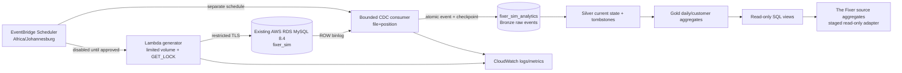

# The Fixer | Synthetic AWS RDS MySQL + True Binlog CDC

**Status: development implementation, not production activated.** Generated 2026-11-06. This is installable code with isolated test assets, not a claim that it already runs on AWS. The `CayelaemJ/NewChanges` production application and its credentials are untouched.

## What this package does

- Operates **only** in `fixer_sim` (source) and `fixer_sim_analytics` (sink). No SQL DDL or mutations against application schemas.
- Simulates inserts, upserts, bulk customers, orders, payments, order status/price updates, historical corrections, late arrivals, logical customer deletion, synthetic financial-transaction hard deletion, duplicate business events, controlled failed transaction and explicit rollback.
- Uses deterministic `SIM_RUN_KEY` and seed, unique business-event keys, bounded volume of 1..200 orders/run, `GET_LOCK` concurrency guard, and a **second DB-backed emergency stop** (`sim_control.enabled=FALSE` by default).
- Reads **actual MySQL row binary logs**, not `updated_at` polling. Supports INSERT/UPDATE/DELETE, durable file/position checkpoint, event-level idempotency and replay, Bronze raw row payloads, Silver current-state/tombstones and targeted Gold daily/customer reaggregation.
- Exposes SQL views: `fixer_sim_analytics.v_daily_sales`, `v_customer_activity`, `v_daily_transactions`, `v_cdc_latency`, `v_cdc_worker_runs`, `v_pipeline_quality`.
- Provides disabled-by-default AWS Lambda + EventBridge Scheduler infrastructure with South African timezone and CloudWatch logs; optional error alarms.

## Verified cloud discovery, 6 November 2026

AWS APIs reported `fixer-synthetic-mysql` in `eu-north-1`: MySQL 8.4.11, `db.t4g.micro`, gp3 20 GB, available, **publicly accessible**, backup retention 1 day, deletion protection enabled, storage encryption enabled, Single-AZ, Enhanced Monitoring disabled, Performance Insights disabled. One ingress rule TCP 3306 was scoped to an IPv4 CIDR and **not** `0.0.0.0/0`. No region Lambda functions or EventBridge Scheduler schedules existed at inspection, and no CloudWatch alarms with prefix `fixer` were present. CloudWatch recorded CPU between about 3.4% and 15.8%, and up to three DB connections in the inspected 3-hour window. This is a momentary snapshot, not a sizing guarantee.

**Still not verified:** MySQL SQL-level schema/tables/columns/views/PK/FK/indexes, whether sensitive rows are present, effective runtime binlog parameters, binlog retention stored-procedure value, database privileges, actual TLS handshake, and source/sink connectivity. AWS RDS management APIs do not expose a regular MySQL server's table data and `information_schema` over the RDS Data API. Obtain a restricted MySQL connection and execute `ops/preflight.sql` after approval.

**Important data security caveat:** MySQL `REPLICATION SLAVE` / `REPLICATION CLIENT` are global privileges, and replication can expose events from other schemas **even when the consumer software filters to `fixer_sim`**. Do not grant binlog access on a mixed sensitive-data instance until its data classification and privileged-access review have passed. For isolation beyond an application-side filter, use a dedicated MySQL instance (new cost, separately approved).

## Architecture



Bronze, Silver and Gold are logical data layers in one small MySQL instance. They do not require S3, DMS, Kafka, Kinesis or another paid analytics cluster. This comes with limits: binlog churn and Gold computation share the micro instance. Benchmark sustained change volume before increasing throughput. If volume grows, move analytics storage and the consumer off the source RDS.

## DEV: run isolated Docker tests first

Requirements: Python 3.12+, Docker Engine + Compose, local ability to pull `mysql:8.4` and `python:3.12-slim`. The Compose file has **no exposed MySQL host port**, runs on an **internal network**, uses tmpfs for database files, and creates short-lived random credentials. It **cannot connect to live RDS**, because service hostnames are fixed as `mysql` inside the private network.

```bash
cd aws-rds-sim
bash ops/ci-docker.sh
```

The script first runs pure unit tests, then creates a disposable MySQL 8.4 instance, installs isolated schemas, grants synthetic test accounts, establishes a binlog checkpoint while source tables are empty, runs simulation, checks FK/idempotency/rollback, exercises INSERT/DELETE row transformations and **attempts an actual binlog read**. It tears down its own Docker project including ephemeral data.

The simulation now rechecks the emergency-stop flag before every committed business event, retains the original run anchor for deterministic retries, and recomputes Gold metrics using indexed affected-day SQL ranges. The MySQL integration suite additionally asserts real binlog DELETE events and replay idempotency, but those tests still require execution.

A successful pure test suite is **not** proof the Docker/CDC integration passed. Current verification in this environment: 13 pure Python tests passed, 4 integration tests skipped because Docker is unavailable. A 2026 MySQL binlog library version `mysql-replication==1.0.17` is pinned, but successful interaction with **this** RDS 8.4 instance is still unverified.

For the existing self-hosted `newchanges-ci` GitHub runner, copy these files under `NewChanges/simulation/` and copy `repo-integration/.github/workflows/aws-sim-docker-ci.yml` to the repository's `.github/workflows/`. Dispatch that workflow manually. It does not use GitHub-hosted runners and does not deploy.

## MySQL 8.4 SHA-2 authentication (local Docker)

MySQL 8.4 defaults to `caching_sha2_password`. Fresh Docker test accounts
require PyMySQL RSA authentication support when using the isolated, non-TLS
Docker network. The test image installs `PyMySQL[rsa]` and pins `cryptography`.
The Docker build verifies these imports, and the preflight checks the backend
and all three restricted account connections **before** CDC bootstrap.

The previous symptom was five `RuntimeError` preflight failures immediately
after local role creation. This was consistent with PyMySQL's missing
`cryptography` dependency, not five independent schema failures. Re-test
against fresh containers; do not disable SHA-2 authentication, weaken
production TLS, or bypass the kill switch.

## Troubleshooting Docker CDC bootstrap (local only)

Before calling `runtime.cdc bootstrap`, Docker runs a **read-only, local-only**
probe which prints one JSON record per stage:

`replica_connection_and_stop`, `source_empty`, `row_binlog_configuration`,
`binlog_status_privilege`, and `analytics_sink_connection`. The final
`local_cdc_preflight` field is `PASS` or `FAIL`. No real database host,
username, SQL exception body or password appears in these records.

If all preflight stages pass but bootstrap raises an unexpected RuntimeError,
the CLI emits `CDC_BOOTSTRAP_STAGE_FAILED` with one of these fixed `stage`
values: `SOURCE_CONNECT`, `SINK_CONNECT`, `SIMULATION_STOP`,
`EMPTY_SOURCE`, `BINLOG_PREFLIGHT`, `SINK_CHECKPOINT`,
`CHECKPOINT_WRITE`. This intentionally does not invent a root cause.
Use the failed stage and MySQL error number (if available) to repair only
the disposable test setup. Never disable the empty-source guard on live RDS.


A failed bootstrap writes a JSON object to stderr containing a fixed `error_code`
rather than printing database driver details. This is intentional: connection
exceptions may include sensitive SQL or host/account details.

| Code | Meaning |
|---|---|
| `CDC_APPROVAL_REQUIRED` | The bootstrap approval environment variable is missing |
| `CDC_SIMULATION_NOT_STOPPED` | The DB kill switch is enabled or missing |
| `CDC_SOURCE_NOT_EMPTY` | At least one synthetic source table contains data; use an approved snapshot hand-off |
| `CDC_LOG_CONFIG_UNSUPPORTED` | Server is not running with binary logging + ROW/FULL images |
| `CDC_BINLOG_STATUS_EMPTY` | The server did not return an active binary-log position |
| `CDC_CHECKPOINT_ALREADY_EXISTS` | A checkpoint already exists; never reset it automatically |

For a local PyMySQL error, output also includes a numeric `mysql_errno`
without any error message, credentials, or connection URL. Do not bypass
bootstrap safety guards to make tests pass. The local Compose test project
uses randomly generated credentials and fresh ephemeral storage every run.

## Local MySQL 8.4 integration validation, 6 November

The operator's disposable MySQL 8.4 log now confirms the RSA dependency,
writer/replication/sink authentication, stopped-and-empty source checks,
`ROW`/`FULL` binlog configuration, binlog access, and initial empty-source
checkpoint bootstrap **PASS**. Three CDC data-layer integration tests and
the isolated generator idempotency test also passed.

The remaining two failures in that run were test-image packaging
(`/app/Dockerfile.test` absent) and a removed constructor parameter
(`fail_on_table_metadata_unavailable`) in the installed
`mysql-replication==1.0.17` reader. Both are fixed in the branch, with a new
test inspecting `BinLogStreamReader` against the installed API. The complete
live row-binlog integration test must still be rerun to prove success.

## Approval gates before **any** AWS schema creation

1. Verify actual MySQL schema inventory and classify sensitive data. No connection to live RDS was attempted from this package.
2. Review 3306 SG rule and authorize Lambda security-group-to-RDS ingress in the same VPC. No automatic RDS SG changes.
3. Confirm daily available free space, active RDS backup/restore expectations and permitted extra binlog retention. Current backup retention is 1 day. Changing it requires an explicit decision.
4. Verify `@@GLOBAL.log_bin=ON`, `@@GLOBAL.binlog_format=ROW`, `@@GLOBAL.binlog_row_image=FULL`, and `CALL mysql.rds_show_configuration`. For recovery, set an appropriate binlog retention window **only after separate approval**, then monitor free storage. This code does not set RDS parameters or retention.
5. Create the source/sink schemas with dedicated administrator-approved migration execution of `schema/*.sql`; do not run migrations on the application schema. Source and sink defaults are disabled. Run **restricted users**, never root/admin.
6. Provide distinct writer (`SELECT/INSERT/UPDATE/DELETE` on `fixer_sim.*`), consumer sink (`SELECT/INSERT/UPDATE/DELETE` on `fixer_sim_analytics.*`), and replica reader (`SELECT` on `fixer_sim.*` plus global replication privileges) accounts. Replication globally exposes other schemas: review this separately.
7. If the source is empty, run `python -m runtime.cdc bootstrap` with `SIM_CDC_BOOTSTRAP_APPROVED=YES_EMPTY_SOURCE_ONLY` **while sim_control is disabled**, before inserting anything. If it is nonempty, **stop**: this package intentionally has no unsafe initial-snapshot shortcut. An atomic snapshot/binlog handoff must be implemented and tested first.
8. Only after tests and consent, set `sim_control.enabled=TRUE` in `fixer_sim` for a restricted operator, enable the synthetic writer approval env, then manually invoke and monitor one low-volume run. Keep schedules disabled until successful verification.

## Local CLI / worker commands

All database credentials must be injected from local secret management or AWS Secrets Manager. **Never print connection strings, log driver errors, or add secrets to GitHub.** The non-local driver requires certificate-verified TLS and an explicit CA path.

```bash
# illustrative environment keys, never commit values
SIM_ENV=aws
SIM_DB_HOST=<approved-host>  SIM_DB_USER=<dedicated-writer>
SIM_DB_PASSWORD=<from-secret> SIM_DB_DATABASE=fixer_sim
SIM_DB_CA=/path/to/rds-global-bundle.pem
SIM_REPL_HOST=<approved-host> SIM_REPL_USER=<dedicated-binlog-reader>
SIM_REPL_PASSWORD=<from-secret> SIM_REPL_DATABASE=fixer_sim
SIM_REPL_CA=/path/to/rds-global-bundle.pem
SIM_CDC_HOST=<approved-host> SIM_CDC_USER=<dedicated-sink-writer>
SIM_CDC_PASSWORD=<from-secret> SIM_CDC_DATABASE=fixer_sim_analytics
SIM_CDC_CA=/path/to/rds-global-bundle.pem
```

```bash
# read-only preflight after restricted source access exists
python -m runtime.cdc preflight
# ONLY for a new, empty, STOPPED simulation source
SIM_CDC_BOOTSTRAP_APPROVED=YES_EMPTY_SOURCE_ONLY python -m runtime.cdc bootstrap
# ONLY after schema/control/user consent
SIMULATION_WRITES_APPROVED=YES_ISOLATED_SYNTHETIC_ONLY SIM_RUN_KEY=manual:20261106:001 python -m runtime.simulator
# consumer is separate, reads REAL row-binlog events
SIM_CDC_ENABLED=true python -m runtime.cdc consume
```

Never run `bootstrap` over a nonempty database. It explicitly rejects this condition and existing checkpoints.

## AWS packaging and deployment (not executed)

`infra/main.tf` targets `eu-north-1`. It creates two restricted-concurrency Lambda functions, Scheduler rules, IAM roles, CloudWatch logging, and optionally error alarms, **only when `deploy=true`**. Both schedules remain `DISABLED`, both Lambda functions have `SIM_LAMBDA_ENABLED=false`, and the generator additionally has `SIMULATION_WRITES_APPROVED=NO`. Deploying infrastructure does **not** automatically activate simulation.

The build helper requires the official AWS RDS CA bundle at `ops/rds-global-bundle.pem`. The file is intentionally not included. Retrieve from the official AWS RDS trust store, validate its source, then build with `bash ops/build-lambda.sh`. An approved existing Secrets Manager JSON secret must supply exact `SIM_DB_*`, `SIM_REPL_*`, `SIM_CDC_*` keys. Terraform **does not create the secret**. Secrets Manager access from private Lambda subnets may need a NAT gateway or VPC Interface Endpoint: **both can add costs**, so approve the network path first.

```bash
cd infra
terraform init
terraform plan   # deploy=false by default: should plan NO resources
# STOP: do not terraform apply or set deploy=true until permissions/pricing sign-off.
```

Intended generator schedule: 08:00, 12:00 and 17:00 South Africa time daily; separate CDC drain every minute. The generator uses the supplied scheduled timestamp to give retry-safe run keys; individual Lambda concurrency is limited to one, and MySQL uses named locks. Lambda has a 90-second timeout and bounded 200-row/40-second CDC work window. No claim has been made that Lambda VPC connectivity, actual role permissions, or runtime resource limits pass yet.

### Emergency stop and rollback

1. Set both EventBridge schedules to `DISABLED` and `SIM_LAMBDA_ENABLED=false`; this prevents new worker actions.
2. Set `fixer_sim.sim_control.enabled=FALSE` (writer fail-closed), and set CDC env `SIM_CDC_ENABLED=false`.
3. Verify there are no active simulation transactions or CDC worker processes; inspect worker run views and CloudWatch errors.
4. Preserve Bronze and checkpoints for forensic replay. **Do not delete the simulation schema or reset the CDC checkpoint automatically.** Re-enable only after an explicit recovery decision.
5. No production application configuration is changed by this package, so the existing application requires no connection rollback.

### Recovery and ordering rules

- The reader stores `source_file + log_pos` alongside Bronze and Silver/Gold changes in the **same sink transaction**. Crash before commit replays the event; replay is deduplicated on `(file,position,row_index)` hash. Crash after commit resumes from the stored checkpoint.
- MySQL may purge a binlog file before resumption. If the required file is missing, **fail closed** and perform an independently approved snapshot/reseed; do not jump to latest position.
- Within this single reader, row-binlog coordinates preserve source order; there is **no distributed exactly-once delivery guarantee** outside this transactional sink. Arbitrary transaction group boundaries and binlog rotation need validation under local failure injection.
- The CDC consumer deliberately processes only the allowlisted tables and requires complete row images. Unexpected schema and unsupported events are rejected. Schema migrations/DDL are **not** automatically applied to Silver.
- Gold recalculates **touched days and customers** only. It does not full-refresh all reports after every change. Historic corrections affect the relevant historical reporting date, not only today.

## The Fixer integration

The existing repository has `src/services/sourceAdapter.ts`, `syncService.ts`, `syncJobs.ts`, `dataQualityService.ts`, `playgroundMysqlSnapshot.ts` and an existing `SOURCE_AGGREGATES` reporting path. **Do not replace the live IntegrationConfig or PostgreSQL read model.** First prove a staged, read-only MySQL adapter with exact mapping from `fixer_sim_analytics.v_daily_sales` and `v_customer_activity` to a new simulation-specific analytics view. The existing ten-feed canonical import workflow is *not* a direct drop-in for this schema. Source-level CDC and Gold publication need their own status in the app. A standalone MySQL connection in DBeaver can inspect these views without any app cutover. Grant the dashboard account `SELECT` on approved views only.

## Cost review, region eu-north-1

- AWS Pricing API returned **USD 0.016 per db.t4g.micro instance-hour** for Stockholm, Single-AZ MySQL, which is roughly **USD 11.68 for 730 hours**, **before gp3 storage, backups, network, monitoring, credits/free-tier eligibility or tax**. This is the underlying existing RDS compute, not an incremental simulation estimate.
- Scheduler publishes a Free Tier allowance of 14 million invocations/month, subject to applicable account terms. For a hypothetical 1-minute CDC schedule (~43,200/month) and 3 daily generator invocations (~90/month), scheduler request usage is far below the published allowance; Lambda compute, CloudWatch, Secrets Manager, endpoint/NAT and RDS storage costs are separate. **Free Scheduler does not make Lambda+VPC networking free.**
- The Cost Explorer query for 1–6 November showed no positive unblended service charges in the returned result. That is **not** evidence that the running RDS instance is free or will remain free; costs can lag or be covered by credits.
- Do not deploy DMS, Kinesis, MSK, NAT gateways, VPC endpoints, CloudWatch alarms or new instances without an itemized cost and explicit approval. No paid resources were provisioned during development.

## Test and verification record

| Gate | Status, 2026-11-06 |
|---|---|
| AWS RDS metadata inspection | PASS, read-only |
| SG not world-open on 3306 | PASS, one non-global IPv4 CIDR rule |
| Existing repo source/sync inspection | PASS, read-only |
| Python pure logic/guard tests | PASS, 13/13 |
| Python compile check | To be recorded after final packaging |
| Disposable MySQL 8.4 integration tests | NOT RUN, Docker absent in authoring environment |
| Binlog INSERT/UPDATE/DELETE on MySQL 8.4 | NOT VERIFIED |
| Live RDS table/schema inventory & PII classification | BLOCKED, MySQL SQL credentials unavailable |
| Live RDS CDC parameter/retention inspection | BLOCKED, SQL access unavailable |
| AWS RDS source/sink schema deployment | NOT ATTEMPTED, requires approval |
| Lambda connectivity and trigger test | NOT ATTEMPTED, requires approval |
| The Fixer application-dashboard wiring | NOT CHANGED, awaits integration contract |
| AWS schedules | DISABLED / not deployed |

## Primary external references

- [Amazon RDS MySQL binlog retention procedures](https://docs.aws.amazon.com/AmazonRDS/latest/UserGuide/mysql-stored-proc-configuring.html)
- [MySQL 8.4 row-based logging](https://dev.mysql.com/doc/refman/8.4/en/replication-options-binary-log.html)
- [AWS EventBridge pricing](https://aws.amazon.com/eventbridge/pricing/)
- [AWS RDS public/private network access](https://docs.aws.amazon.com/AmazonRDS/latest/gettingstartedguide/security-public-private.html)
- [Python MySQL binlog replication library](https://pypi.org/project/mysql-replication/)

No production access credentials, personal data, RDS connection URL or hardcoded real password is stored in this package.
